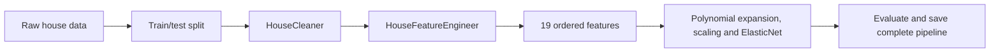

# King County: From Notebook to Python

[](https://github.com/roy-nfisch/mle-refactoring-project/actions/workflows/ci.yml?query=branch%3Amain)
[](#test-categories-and-ci-stages)
[](#run-locally)
[](#run-with-docker-compose)
[](#publish-to-github-container-registry)

We are refactoring a house-price notebook into a small, object-oriented Python project. The goal is to make its preprocessing reusable, testable, and eventually usable by a prediction application—not to build another training service.

This is a portfolio project developed during the neue fische MLE course. It builds on the supplied King County notebook and dataset, with our own Python package, validation, tests, and CI.

## What works today

- **Reusable preprocessing:** `HouseCleaner` and `HouseFeatureEngineer` run together in a scikit-learn pipeline.
- **Clear responsibilities:** validation checks inputs; the cleaner transforms them; the feature object calculates distances and returns 19 ordered model inputs.
- **Stored reference data:** fitting remembers training waterfront coordinates. Transforming new houses reuses those coordinates without fitting again.
- **Notebook training and export:** raw-data splitting, training-only grid search, held-out evaluation, and a complete saved pipeline with metadata and checksum.
- **Reload verification:** a fresh Python process reproduces predictions using only the exported bundle and installed package, without the training CSV.
- **Prediction API:** FastAPI validates the 17 raw inputs and calls the shared `PredictionService`; the verified model loads once at startup.
- **Regression tests:** controlled examples check that the refactor preserves the original preprocessing results.
- **Development checks:** pytest, Ruff, and a package build run in GitHub Actions.
- **Local Docker:** a non-root API image and Compose setup load the approved model from a read-only mount; container smoke checks have a separate CI job.

**Prepared, not yet run:** manual GHCR publishing. Cloud deployment remains deferred. The API runs locally and has no authentication; do not expose it publicly as-is. See [tasks.md](tasks.md) for progress.

## The flow



Training, evaluation, and model saving stay in the notebook. The application loads the saved pipeline and predicts; it does not run the notebook or retrain during requests.

The notebook first fits preprocessing on all retained rows **only for the original-baseline comparison**. Its separate modelling section splits raw inputs first and fits a fresh complete pipeline inside each training fold. The evaluation never reuses the full-data baseline object.

## Run locally

Install [uv](https://docs.astral.sh/uv/getting-started/installation/) 0.13.5 or newer. The project uses Python 3.13.17 or a newer 3.13 patch release.

```bash
git clone https://github.com/roy-nfisch/mle-refactoring-project.git
cd mle-refactoring-project
uv sync --locked
```

Open [King-County-refactored.ipynb](King-County-refactored.ipynb) in your notebook editor, select the project's `.venv` kernel, and run it from the project root. It reads the bundled CSV, checks preprocessing, then trains and evaluates the complete pipeline. Review the results before running the export cells; they create a new ignored local bundle and never overwrite the original model.

For the original EDA and modelling workflow, see [King-County.ipynb](King-County.ipynb).

### Use the preprocessing package

```python
import pandas as pd
from sklearn.pipeline import Pipeline

from king_county.cleaning import HouseCleaner
from king_county.features import HouseFeatureEngineer

training_houses = pd.read_csv("data/King_County_House_prices_dataset.csv")
preprocessor = Pipeline([
    ("cleaning", HouseCleaner()),
    ("features", HouseFeatureEngineer()),
])
# In model evaluation, pass only the training split here.
prepared = preprocessor.fit_transform(training_houses)
print(prepared.shape)
```

Use `preprocessor.transform(new_houses)` afterwards to reuse the fitted references. The training input must contain at least one waterfront house. Invalid or missing required inputs raise an error rather than receiving guessed values.

## Run the checks

```bash
uv run --locked ruff check .
uv run --locked ruff format --check .
uv run --locked pytest tests/
uv build
```

### Test categories and CI stages

Tests keep their source-mirroring folders. Pytest markers map each test to one purpose:

| Category | Tests mapped here | Run locally |
|---|---|---|
| Unit | Cleaning, features, validation, Pydantic schemas, settings, logging, isolated trace/middleware checks, and mocked Docker-helper regressions | `uv run --locked pytest -m unit` |
| Integration | Scikit-learn pipeline wiring, artifact loading, prediction service with a fitted artifact, installed-package subprocesses, notebooks, API routes/traces, real containers, and Compose configuration | `uv run --locked pytest -m "integration and not docker" -n 2 --dist loadfile` |
| Contract | Independently pinned public API request, response, and error expectations in `tests/api/test_contract.py` | `uv run --locked pytest -m contract` |

Whole files use `pytestmark = pytest.mark.unit` (or `integration`/`contract`); mixed files mark individual tests with `@pytest.mark.unit`, for example. Every test must have exactly one category; collection fails for missing/overlapping categories or unknown marker names. `docker` is an additional runtime label, not a fourth category: real Docker/Compose tests are marked both `integration` and `docker`. Mocked Docker-helper checks remain unit tests.

CI runs lint/format/build first. Unit, non-Docker integration, and contract jobs then run on `ubuntu-slim`, alongside the Docker integration job on `ubuntu-26.04`. The explicit Docker runner label selects Ubuntu 26.04 directly instead of following future OS migrations of `ubuntu-latest`; it does not freeze runner tool updates. Selections do not overlap, so each test runs once across these test jobs. All jobs must pass before merging; GitHub branch-protection settings are managed separately.

The development-only `pytest-xdist` plugin runs non-Docker integration tests with two worker processes. `--dist loadfile` keeps each file on one worker, so the notebook's module-scoped export fixture is not repeated across workers. Unit and contract cases remain serial within their own jobs: worker startup did not improve the measured unit run, and the contract checks share one file. Docker cases also remain serial within their job to keep resource use predictable. Use `-n 0` to debug an integration test without workers. Worker counts are explicit rather than automatically consuming every available CPU. See the [pytest-xdist distribution guide](https://pytest-xdist.readthedocs.io/en/stable/distribution.html).

Tests mirror the source packages: `src/king_county/` → `tests/king_county/` and `src/api/` → `tests/api/`. Notebook regression tests live in `tests/notebooks/`; dataset/model fixtures stay at the test root, and API client setup lives in `tests/api/conftest.py`. Container smoke tests live in `tests/docker/` and skip unless `DOCKER_TEST_IMAGE` names a built image. `tests/workflows/` covers release checks offline: mocked registry checks are unit tests, and the smoke-check shell with Docker/curl stand-ins is integration tested. These tests never log in or publish.

CI runs these stages on pushes and pull requests. Export integration tests fit a tiny controlled model in temporary storage; CI does not run the full training grid, publish, deploy, or need API keys or a pre-existing model artifact.

### What the integration tests connect

| Check | What it protects |
|---|---|
| Notebook training/export → verified loader → API prediction | The API reproduces held-out predictions from the notebook's small ElasticNet test run, not only a dummy model. |
| Reordered JSON fields → ordered model features | Sending the same house fields in a different order does not change the result. |
| Startup and prediction with fitting/CSV reads blocked | The exported model is enough; serving a prediction must not retrain or reopen the dataset. |
| Truncated, altered, or replaced model archives → checksum rejection | Unapproved bytes never reach type inspection or deserialisation. |
| Invalid house JSON or unusable model output → HTTP error | Validation and failure handling work across the API/service boundary. |

These tests reuse the supplied CSV and temporary artifacts. Only the test export's checksum is approved in memory for that test; production approval constants are unchanged. The checks establish that the parts work together, **not** that a model is accurate on future house sales.

### API contract tests

`tests/api/test_contract.py` pins the public agreement: the 17 required request fields, their JSON types and nullability, the prediction response fields/types, and the safe validation-error format. Expectations are written independently of the application schemas so an accidental breaking change fails CI. Intentional API changes require reviewing these expectations, not automatically regenerating them. These checks protect API clients; they do not measure prediction accuracy or replace the existing boundary tests. API tests share the real app/client fixture in `tests/api/conftest.py` and reuse the temporary approved model.

## Repository layout

```text
mle-refactoring-project/
├── .github/workflows/ci.yml       # Automated development checks
├── .github/workflows/publish-image.yml # Manual GHCR publishing after image tests
├── .github/scripts/check_image_version.py # Reject reused tags and registry errors
├── Dockerfile                    # Locked installation and non-root API runtime
├── .dockerignore                 # Exclude models, data, notebooks and secrets
├── compose.yaml                  # Local API and read-only model mount
├── src/api/
│   ├── __init__.py
│   ├── errors.py                 # Safe 422 errors without raw input values
│   ├── main.py                   # App factory and one-time startup loading
│   ├── request_validation.py     # Reject duplicate JSON keys before prediction
│   ├── routes.py                 # Predict, readiness and error responses
│   ├── settings.py               # Model path and logging configuration
│   └── traceability.py           # Request identity, timing and metadata logging
├── src/king_county/
│   ├── __init__.py
│   ├── artifacts.py              # Code-pinned checksum and verified loader
│   ├── cleaning.py               # Copy-first cleaning rules
│   ├── features.py               # Fitted distances and ordered features
│   ├── prediction.py             # Shared prediction service; no training
│   ├── schemas.py                # Pydantic house and price contracts
│   ├── validation.py             # Cleaning and feature input checks
│   ├── settings.py               # Pydantic logging settings
│   └── logging_config.py         # Console logging setup
├── tests/
│   ├── conftest.py               # Shared fixtures from the existing CSV
│   ├── king_county/              # Tests matching the Python package
│   ├── api/                      # Shared client, API contracts, HTTP and settings
│   │   ├── conftest.py           # Shared API client with a temporary approved model
│   │   ├── test_contract.py      # Public request, response and error contracts
│   │   ├── test_routes.py        # Startup, prediction and HTTP failure handling
│   │   ├── test_settings.py      # API configuration and environment checks
│   │   └── test_traceability.py  # Request IDs, trace metadata and privacy
│   ├── notebooks/                # Regression, training boundaries and export/reload
│   ├── docker/test_container.py   # Container lifecycle, health, HTTP and Compose checks
│   ├── workflows/                # Offline registry checks and smoke-check failures
│   └── fixtures/                 # Fixed expectations, not a duplicate CSV
├── docs/
│   ├── design.md                 # Class responsibilities and planned app
│   └── notebook-baseline.md      # Original rules and comparison details
├── data/King_County_House_prices_dataset.csv
├── model/versions/king-county-20261028T153712021211Z/
│   └── pipeline.skops            # Single checksum-approved inference pipeline
├── assets/                       # Notebook images
├── examples/house.json           # Feature-only record from the supplied CSV
├── King-County.ipynb              # Original EDA and modelling reference
├── King-County-refactored.ipynb    # Preprocessing, training, evaluation and export
├── pyproject.toml                # Dependencies and development configuration
├── uv.lock                       # Locked dependencies
├── .python-version
├── .gitignore
├── project-description.md        # Course assignment for context
├── tasks.md                      # Progress and next steps
├── README.md
└── LICENSE
```

Only the versioned `pipeline.skops` shown above is allowed by `.gitignore`; the original `model.bin`, other exports, metadata, and reload examples stay ignored. Generated files, virtual environments, and local course references are also excluded.

## Prediction inputs and limitations

The model uses **19 prepared features**. The API accepts **17 raw fields** and derives basement area, the construction/renovation field, and distances. Missing information produces a validation error; supporting fewer fields would require a separately trained and evaluated model. See [the input design](docs/design.md#what-if-we-do-not-have-all-the-inputs).

The data covers **2014–2015**. This is an educational project, not a current property valuation service. The verified refactored run on 28 October 2026 achieved held-out **R² 0.8447**, **MAE $94,808**, and **RMSE $143,443**, using 15,117 training and 6,479 test rows. These are measured results on one shuffled split, not percentage accuracy or proof of performance on future sales. Repeated house IDs can cross the split. Regression tests establish preprocessing compatibility, while this separate evaluation measures prediction quality.

### Exported files

The notebook saves `pipeline.skops`, `metadata.json`, and `reload-example.json` under a new timestamped `model/versions/king-county-…/` directory. Metadata records the input contract, metrics, data checksum, versions, and model SHA-256. The reload example contains three held-out feature-only records and their expected predictions. New exports remain local and ignored unless deliberately approved; rerunning export with the same directory fails rather than overwriting it.

**Why include one trained model?** The `pipeline.skops` file (about 72 KB) lets a fresh clone run the API and Docker demo without retraining or requesting a separate model download. It contains preprocessing and the fitted estimator, not just prediction weights. The original `model.bin` is a reference artifact and is not used by the API. Keeping one approved version also makes the demo reproducible; an arbitrary new export is not automatically trusted.

**Artifact review:** the approved file matches the SHA-256 pinned in `src/king_county/artifacts.py` and loads with only the two expected custom transformer types. It retains 105 training waterfront coordinate pairs, scaling statistics, and fitted model parameters; it is not anonymised or free of training-derived data. No credential-like fields were found in the archive schema, but that inspection is not a comprehensive security certification. Before public release, confirm permission to redistribute the course dataset and its retained coordinates: the repository has an MIT software license, but no separate dataset source/license notice was found. This remains an open release check in `tasks.md`.

The notebook's fresh-process check verifies the bytes and permits only the two named custom transformer types. It checks serialization, not model quality or release approval. See [the export reference](docs/notebook-baseline.md#model-training-and-export) for details.

The model loader verifies the code-pinned SHA-256 before loading the same bytes and permits only the two named custom transformer types. This checks artifact integrity, not model quality or the safety of an untrusted file. It does not trust a colocated metadata checksum.

## Run the prediction API

Use the approved versioned artifact listed above. From the project root:

```bash
uv sync --locked
uv run --locked uvicorn api.main:create_app --factory --host 127.0.0.1 --port 7002
```

Open [interactive docs](http://127.0.0.1:7002/docs) or send the dataset example:

```bash
curl http://127.0.0.1:7002/health
curl -X POST http://127.0.0.1:7002/predict \
  -H 'Content-Type: application/json' \
  --data-binary @examples/house.json
```

The response contains `predicted_price`, `currency` (`USD`), and `model_version`. `/health` reports readiness after model loading, not prediction quality. Missing/invalid fields return **422**; model/output failures return **500**. Non-finite or non-positive prices fail explicitly rather than being clamped.

ZIP codes must be five-digit strings; the service converts them to the model's numeric feature. Numeric fields reject strings and booleans. Years/counts are whole numbers, areas and coordinates are finite, and above-ground area cannot exceed living area. The keys `view`, `waterfront`, and `yr_renovated` are required but may be `null`, following the notebook's cleaning rules. There is no address lookup or guarantee that any in-range location is suitable for this historical model.

Duplicate JSON keys return **422**, even when their values are identical or their names use equivalent Unicode escapes. Raw-body validation checks this before prediction, since normal dictionary parsing would silently keep only the last occurrence.

Technical input limits also reject oversized numbers with **422** before prediction: counts and years must fit nonnegative int64 (`2**63 - 1` maximum), and measurements are capped at `2**53 - 1`, float64's consecutive-integer precision limit. The measurement cap is a conservative application policy that also keeps degree-two products finite—not a realistic house-size limit or a guarantee of accurate predictions. A model may still reject an otherwise valid request or produce an unusable price.

### Supply or deliberately replace the model

`src/king_county/artifacts.py` pins the reviewed model version, SHA-256, and default export path. `MODEL_PATH` can point to another location containing **the same approved bytes**; `LOG_LEVEL` controls logging. No `.env` file is loaded automatically, and no environment setting overrides the approved checksum.

The approved artifact is intended to be versioned alongside the code so a fresh clone can start without training. To create a replacement, run the notebook, review its evaluation/export and redistribution suitability, then deliberately update `MODEL_VERSION`, `EXPECTED_MODEL_SHA256`, the exact `.gitignore` exception, and Compose's default model path together. A re-export may have a different checksum even with identical predictions. Never calculate and accept a new expected checksum automatically at startup. The model stays outside the Docker image and is mounted read-only at runtime.

### Run with Docker Compose

From the project root, with Docker running and the approved local model available:

```bash
docker compose up --build --wait
curl http://127.0.0.1:7003/health
curl -X POST http://127.0.0.1:7003/predict \
  -H 'Content-Type: application/json' --data-binary @examples/house.json
docker compose logs api
# Stop this project's container when finished:
docker compose down
```

Open [Docker API docs](http://127.0.0.1:7003/docs). Host port **7003** forwards to **8000 inside the container**; the API listens on all container interfaces, but Compose publishes it only on localhost. If 7003 is busy, use `API_PORT=7004 docker compose up --build --wait` and change the curl/browser port accordingly.

The non-root runtime contains the installed package and locked runtime dependencies, not the CSV, notebooks, tests, or model. Compose mounts the approved artifact read-only at `/models/pipeline.skops`; no database, training service, or API key is needed. The health check succeeds only after startup loads the model. A missing host file fails the mount; changed/unapproved bytes fail application startup. Check `docker compose logs api` if startup fails.

To relocate the same approved model, set `MODEL_FILE=/absolute/path/pipeline.skops` before the Compose command. This changes only the host file location, **not** its trusted checksum. The default image command performs the usual code-pinned verification; no new checksum environment override is provided.

To run container tests locally:

```bash
docker build -t king-county-api:test .
DOCKER_TEST_IMAGE=king-county-api:test uv run --locked pytest tests/docker/
```

To run only the Docker-enabled integration stage used by CI, replace the last command with `DOCKER_TEST_IMAGE=king-county-api:test uv run --locked pytest -m "integration and docker"`. This excludes the helper unit tests, which already run in the unit stage.

These tests reuse the existing temporary model fixture. The healthy test process explicitly approves that fixture's digest **in memory through a test-only Python startup command**; it does not change the image, production code, or normal entrypoint. Another test verifies that the normal command rejects this unapproved model.

A small `DockerContainer` test helper owns creation and cleanup, including client timeouts and startup failures. Readiness requires Docker's actual health status; failures include both stdout and stderr. Checks also pin Compose's localhost port and read-only model mount with missing-file protection. Helper regression tests run without Docker; real-container and Compose checks require `DOCKER_TEST_IMAGE`. This checks packaging and HTTP wiring, not production model quality or deployment readiness.

The Docker test file has 13 cases: seven helper regressions, three real-container checks (prediction, checksum rejection, timeout cleanup), and three Compose configuration checks. Invalid-request behaviour stays in the existing API tests instead of being repeated in Docker.

### Publish to GitHub Container Registry

The manual **Publish API image** workflow is prepared but has not been run. Once reviewed and merged to `main`, open **Actions → Publish API image → Run workflow**, select `main`, and enter a new version using `YYYY.MM.DD`, such as `2026.10.28`. For another release on the same date, append `.1`, `.2`, etc., such as `2026.10.28.1`. Dates must be real calendar dates with two-digit months/days, and an optional suffix must be a positive integer without leading zeros. Pushes and pull requests do not publish images, and a manual run from another branch is rejected.

The workflow builds and tests the image, transfers that exact image between jobs, and checks its image ID before publishing. Only the publishing job has `packages: write`; authentication uses GitHub's short-lived `GITHUB_TOKEN`, not a personal token stored in this repository. The version is the image tag: `ghcr.io/roy-nfisch/mle-refactoring-project:2026.10.28` (or the selected date/suffix). It also publishes a `sha-<full-commit>` tag and updates `latest` only after post-publish health and prediction checks pass. `latest` means the last successfully verified manual publication, not necessarily the highest date tag. The workflow does not change package visibility. New GHCR packages default to private; review package access settings before sharing, even when the repository is public. See [GitHub's registry documentation](https://docs.github.com/en/packages/working-with-a-github-packages-registry/working-with-the-container-registry).

Before pushing, an authenticated registry check rejects an existing version tag. Only an explicit missing-manifest/name response permits publication; authentication, network, malformed-response, and other registry errors stop the job. Workflow runs are serialized, but this is not registry-enforced immutability: someone publishing outside this workflow could still change a tag.

After pushing, it pulls by registry digest and checks health and prediction with the approved model mounted read-only. HTTP checks have a five-second connection timeout and a 15-second total timeout per request. The run summary records the digest reference. Publishing creates a downloadable image, not a hosted API. If post-push verification fails, the workflow fails but does not automatically delete already-pushed tags. Choose a new version for the next attempt rather than overwriting an existing tag.

For later use, replace `DIGEST_FROM_RUN` below with the recorded `sha256:…` value. Private images require local Docker authentication first. Choose new version tags for releases; tags can move, while the recorded digest identifies the exact image. The initial workflow builds Linux amd64 only; an ARM Mac needs Docker's amd64 emulation.

```bash
docker pull ghcr.io/roy-nfisch/mle-refactoring-project@DIGEST_FROM_RUN
docker run --rm --platform linux/amd64 -p 127.0.0.1:7003:8000 \
  --mount "type=bind,source=$(pwd)/model/versions/king-county-20261028T153712021211Z/pipeline.skops,target=/models/pipeline.skops,readonly" \
  ghcr.io/roy-nfisch/mle-refactoring-project@DIGEST_FROM_RUN
```

Keep the model outside the image. Dataset/model redistribution permission remains an open review item; do not treat this workflow as publication clearance. The registry itself and a published-image pull cannot be verified until an explicitly approved publishing run.

### Prediction traceability

Traceability helps us answer: **“What happened to this prediction request?”** Each call to `/predict` gets a unique ID and a short record in the server terminal—even when the input is rejected.

| Recorded field | What it tells us |
|---|---|
| `request_id` | Which request we are looking at. |
| `timestamp` | When it started, in UTC. |
| `model_version` | Which loaded model handled the request. |
| `outcome` | Did it succeed, reject invalid input, or fail? |
| `status_code` | Which HTTP status started the response, such as 200 or 422. |
| `duration_ms` | How long the request took, in milliseconds. |

**Example:** someone reports a failed prediction. We take the `X-Request-ID` from their response headers and search the server logs for the same ID. This tells us which model was used, what happened, and how long it took. It does **not** tell us whether the predicted price was accurate.

To see the response headers, add `-i` to the example request:

```bash
curl -i -X POST http://127.0.0.1:7002/predict \
  -H 'Content-Type: application/json' \
  --data-binary @examples/house.json
```

We log **no house details, predicted prices, or exception text** in these trace records. The app writes them to standard logging, not a dedicated file or database; your terminal or hosting platform may retain them. Keep `LOG_LEVEL=INFO` to see them. Health checks and documentation visits do not create prediction records.

If processing is interrupted, the outcome is `failed` even if a 200 response had already started. No started response means `status_code` is `null`. Unexpected server errors may return a generic 500 without the request-ID header. See [the design notes](docs/design.md#a-lightweight-audit-not-another-platform) for technical details.

Saving prediction results is still deferred. Authentication, Docker, and deployment remain separate work. Keep this local prototype bound to `127.0.0.1`.

## Project notes

- [Design and diagrams](docs/design.md): responsibilities, notebook mapping, and prediction flow.
- [Baseline reference](docs/notebook-baseline.md): preserved rules and regression checks.
- [Task list](tasks.md): completed work and next steps.
- [Original assignment](project-description.md): the course requirements behind this project.

The course's optional CRUD/database example is not part of this project's current implementation. Its local reference copy is excluded from Git. The current application predicts prices; it does not store or edit house records.
