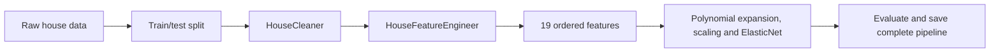

# King County: From Notebook to Python

We are refactoring a house-price notebook into a small, object-oriented Python project. The goal is to make its preprocessing reusable, testable, and eventually usable by a prediction application—not to build another training service.

This is a portfolio project developed during the neue fische MLE course. It builds on the supplied King County notebook and dataset, with our own Python package, validation, tests, and CI.

## What works today

- **Reusable preprocessing:** `HouseCleaner` and `HouseFeatureEngineer` run together in a scikit-learn pipeline.
- **Clear responsibilities:** validation checks inputs; the cleaner transforms them; the feature object calculates distances and returns 19 ordered model inputs.
- **Stored reference data:** fitting remembers training waterfront coordinates. Transforming new houses reuses those coordinates without fitting again.
- **Notebook training and export:** raw-data splitting, training-only grid search, held-out evaluation, and a complete saved pipeline with metadata and checksum.
- **Reload verification:** a fresh Python process reproduces predictions using only the exported bundle and installed package, without the training CSV.
- **Prediction API:** FastAPI validates the 17 raw inputs and calls the shared `PredictionService`; the verified model loads once at startup.
- **Regression tests:** controlled examples check that the refactor preserves the original preprocessing results.
- **Development checks:** pytest, Ruff, and a package build run in GitHub Actions.

**Still planned:** request-level traceability, Docker, and deployment. The API currently runs locally and has no authentication; do not expose it publicly as-is. See [tasks.md](tasks.md) for progress.

## The flow



Training, evaluation, and model saving stay in the notebook. The application loads the saved pipeline and predicts; it does not run the notebook or retrain during requests.

The notebook first fits preprocessing on all retained rows **only for the original-baseline comparison**. Its separate modelling section splits raw inputs first and fits a fresh complete pipeline inside each training fold. The evaluation never reuses the full-data baseline object.

## Run locally

Install [uv](https://docs.astral.sh/uv/getting-started/installation/) 0.13.5 or newer. The project uses Python 3.13.17 or a newer 3.13 patch release.

```bash
git clone https://github.com/roy-nfisch/mle-refactoring-project.git
cd mle-refactoring-project
uv sync --locked
```

Open [King-County-refactored.ipynb](King-County-refactored.ipynb) in your notebook editor, select the project's `.venv` kernel, and run it from the project root. It reads the bundled CSV, checks preprocessing, then trains and evaluates the complete pipeline. Review the results before running the export cells; they create a new ignored local bundle and never overwrite the original model.

For the original EDA and modelling workflow, see [King-County.ipynb](King-County.ipynb).

### Use the preprocessing package

```python
import pandas as pd
from sklearn.pipeline import Pipeline

from king_county.cleaning import HouseCleaner
from king_county.features import HouseFeatureEngineer

training_houses = pd.read_csv("data/King_County_House_prices_dataset.csv")
preprocessor = Pipeline([
    ("cleaning", HouseCleaner()),
    ("features", HouseFeatureEngineer()),
])
# In model evaluation, pass only the training split here.
prepared = preprocessor.fit_transform(training_houses)
print(prepared.shape)
```

Use `preprocessor.transform(new_houses)` afterwards to reuse the fitted references. The training input must contain at least one waterfront house. Invalid or missing required inputs raise an error rather than receiving guessed values.

## Run the checks

```bash
uv run --locked ruff check .
uv run --locked ruff format --check .
uv run --locked pytest tests/
uv build
```

Tests mirror the source packages: `src/king_county/` → `tests/king_county/` and `src/api/` → `tests/api/`. Notebook regression tests live in `tests/notebooks/`; shared fixtures stay at the test root. The same CI command discovers all three folders.

CI runs lint, formatting, tests, and the package build on pushes and pull requests. Export integration tests fit a tiny controlled model in temporary storage; CI does not run the full training grid, deploy, or need API keys or a pre-existing model artifact.

## Repository layout

```text
mle-refactoring-project/
├── .github/workflows/ci.yml       # Automated development checks
├── src/api/
│   ├── __init__.py
│   ├── errors.py                 # Safe 422 errors without raw input values
│   ├── main.py                   # App factory and one-time startup loading
│   ├── request_validation.py     # Reject duplicate JSON keys before prediction
│   ├── routes.py                 # Predict, readiness and error responses
│   └── settings.py               # Model path and logging configuration
├── src/king_county/
│   ├── __init__.py
│   ├── artifacts.py              # Code-pinned checksum and verified loader
│   ├── cleaning.py               # Copy-first cleaning rules
│   ├── features.py               # Fitted distances and ordered features
│   ├── prediction.py             # Shared prediction service; no training
│   ├── schemas.py                # Pydantic house and price contracts
│   ├── validation.py             # Cleaning and feature input checks
│   ├── settings.py               # Pydantic logging settings
│   └── logging_config.py         # Console logging setup
├── tests/
│   ├── conftest.py               # Shared fixtures from the existing CSV
│   ├── king_county/              # Tests matching the Python package
│   ├── api/                      # Startup, HTTP and API settings checks
│   ├── notebooks/                # Regression, training boundaries and export/reload
│   └── fixtures/                 # Fixed expectations, not a duplicate CSV
├── docs/
│   ├── design.md                 # Class responsibilities and planned app
│   └── notebook-baseline.md      # Original rules and comparison details
├── data/King_County_House_prices_dataset.csv
├── assets/                       # Notebook images
├── examples/house.json           # Feature-only record from the supplied CSV
├── King-County.ipynb              # Original EDA and modelling reference
├── King-County-refactored.ipynb    # Preprocessing, training, evaluation and export
├── pyproject.toml                # Dependencies and development configuration
├── uv.lock                       # Locked dependencies
├── .python-version
├── .gitignore
├── project-description.md        # Course assignment for context
├── tasks.md                      # Progress and next steps
├── README.md
└── LICENSE
```

The local `model/` folder is ignored and is not included in a fresh clone. Generated files, virtual environments, and local course references are also excluded.

## Prediction inputs and limitations

The model uses **19 prepared features**. The API accepts **17 raw fields** and derives basement area, the construction/renovation field, and distances. Missing information produces a validation error; supporting fewer fields would require a separately trained and evaluated model. See [the input design](docs/design.md#what-if-we-do-not-have-all-the-inputs).

The data covers **2014–2015**. This is an educational project, not a current property valuation service. The verified refactored run on 28 October 2026 achieved held-out **R² 0.8447**, **MAE $94,808**, and **RMSE $143,443**, using 15,117 training and 6,479 test rows. These are measured results on one shuffled split, not percentage accuracy or proof of performance on future sales. Repeated house IDs can cross the split. Regression tests establish preprocessing compatibility, while this separate evaluation measures prediction quality.

### Exported files

The notebook saves `pipeline.skops`, `metadata.json`, and `reload-example.json` under a new timestamped `model/refactored/king-county-…/` directory. Metadata records the input contract, metrics, data checksum, versions, and model SHA-256. The reload example contains three held-out feature-only records and their expected predictions. All exports remain local and ignored; rerunning export with the same directory fails rather than overwriting it.

The notebook's fresh-process check verifies the bytes and permits only the two named custom transformer types. It checks serialization, not model quality or release approval. See [the export reference](docs/notebook-baseline.md#model-training-and-export) for details.

The model loader verifies the code-pinned SHA-256 before loading the same bytes and permits only the two named custom transformer types. This checks artifact integrity, not model quality or the safety of an untrusted file. It does not trust a colocated metadata checksum.

## Run the prediction API

The approved local export must be available first. From the project root:

```bash
uv sync --locked
uv run --locked uvicorn api.main:create_app --factory --host 127.0.0.1 --port 7002
```

Open [interactive docs](http://127.0.0.1:7002/docs) or send the dataset example:

```bash
curl http://127.0.0.1:7002/health
curl -X POST http://127.0.0.1:7002/predict \
  -H 'Content-Type: application/json' \
  --data-binary @examples/house.json
```

The response contains `predicted_price`, `currency` (`USD`), and `model_version`. `/health` reports readiness after model loading, not prediction quality. Missing/invalid fields return **422**; model/output failures return **500**. Non-finite or non-positive prices fail explicitly rather than being clamped.

ZIP codes must be five-digit strings; the service converts them to the model's numeric feature. Numeric fields reject strings and booleans. Years/counts are whole numbers, areas and coordinates are finite, and above-ground area cannot exceed living area. The keys `view`, `waterfront`, and `yr_renovated` are required but may be `null`, following the notebook's cleaning rules. There is no address lookup or guarantee that any in-range location is suitable for this historical model.

Duplicate JSON keys return **422**, even when their values are identical or their names use equivalent Unicode escapes. Raw-body validation checks this before prediction, since normal dictionary parsing would silently keep only the last occurrence.

### Supply or deliberately replace the model

`src/king_county/artifacts.py` pins the reviewed model version, SHA-256, and default export path. `MODEL_PATH` can point to another location containing **the same approved bytes**; `LOG_LEVEL` controls logging. No `.env` file is loaded automatically, and no environment setting overrides the approved checksum.

The model is ignored, so a fresh clone intentionally cannot start the API until an approved artifact is supplied. To create a replacement, run the notebook, review its evaluation/export, then deliberately update `MODEL_VERSION` and `EXPECTED_MODEL_SHA256` in code before launching. A re-export may have a different checksum even with identical predictions. Never calculate and accept a new expected checksum automatically at startup.

The API does not save requests or prediction results. Request IDs, result persistence, authentication, Docker, and deployment remain separate work. Keep this local prototype bound to `127.0.0.1`.

## Project notes

- [Design and diagrams](docs/design.md): responsibilities, notebook mapping, and prediction flow.
- [Baseline reference](docs/notebook-baseline.md): preserved rules and regression checks.
- [Task list](tasks.md): completed work and next steps.
- [Original assignment](project-description.md): the course requirements behind this project.

The course's optional CRUD/database example is not part of this project's current implementation. Its local reference copy is excluded from Git. The current application predicts prices; it does not store or edit house records.
