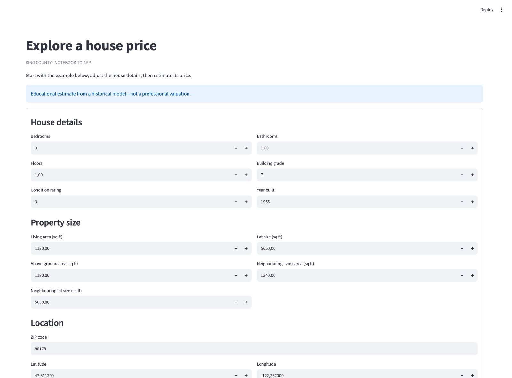
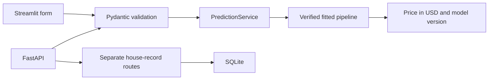

# King County: From Notebook to Python

[](https://github.com/roy-nfisch/mle-refactoring-project/actions/workflows/ci.yml?query=branch%3Amain)
[](#test-categories-and-ci-stages)
[](#run-locally)
[](#run-locally)
[](#run-with-docker-compose)
[](#run-the-published-image)

We turned a house-price notebook into a small, object-oriented Python package,
a prediction API and a local app. Our focus was making the notebook's behaviour
reusable, testable and easy for someone else to run.

This portfolio project was developed during the neue fische MLE course. The
course supplied the King County notebook, dataset and modelling starting point.
We built the Python application, validation, tests and delivery workflow around it.

[Try the app](#run-locally) · [Technology choices](#technologies-and-why-we-used-them) · [Architecture](#the-flow) · [Tests](#run-the-checks)



*The local Streamlit app uses the saved model. No API server or retraining is needed.*

## What we built

- **Reusable preprocessing:** small `HouseCleaner` and `HouseFeatureEngineer`
  objects compose a scikit-learn pipeline, with tests against the original notebook.
- **Shared prediction:** FastAPI and Streamlit use the same Pydantic input
  contract, verified model loader and `PredictionService`.
- **Separate house storage:** five-field CRUD uses SQLite without coupling
  stored records to the model's 17-field prediction input.
- **Tested delivery:** unit, integration and API contract tests run in CI.
  Docker packages the API; a private Codespace was used to verify it remotely.

Training, evaluation and model export stay in the notebook, not in a training
service. For the journey and challenges, read the [notebook-to-app walkthrough](docs/notebook-to-app.md)
or view the [five-slide summary (PDF)](docs/project-overview.pdf).

## Run locally

Use Python 3.13.17 or a newer 3.13 patch and
[uv](https://docs.astral.sh/uv/getting-started/installation/) 0.13.5 or newer.
From a fresh clone:

```bash
git clone https://github.com/roy-nfisch/mle-refactoring-project.git
cd mle-refactoring-project
uv sync --locked --extra ui
uv run --locked --extra ui streamlit run src/king_county/streamlit/app.py --server.address 127.0.0.1
```

Open [localhost:8501](http://127.0.0.1:8501), keep the supplied example and select
**Estimate price**. The approved model returns approximately **$323,409.49 USD**,
with its model version. Try changing a field to see validation and prediction
in action. Stop the server with Ctrl+C.

The checkout includes one approved model, so running the app does not require
training or an API key. See the [UI guide](docs/streamlit-ui.md) for input rules,
model requirements and private Codespaces access.

### Run the prediction API

For the API alone, the optional UI dependency is not needed:

```bash
uv sync --locked
uv run --locked uvicorn api.main:create_app --factory --host 127.0.0.1 --port 7002
```

Open [interactive API docs](http://127.0.0.1:7002/docs). In another terminal,
from the project root:

```bash
curl --fail http://127.0.0.1:7002/health
curl --fail http://127.0.0.1:7002/predict \
  -H 'Content-Type: application/json' --data-binary @examples/house.json
```

Prediction returns a price, currency and model version. The [API and model guide](docs/api-and-model.md)
covers validation, artifact approval, configuration and request tracing.
The [house CRUD guide](docs/house-crud.md) covers separate record storage.

### Run with Docker Compose

With Docker running, use the same checkout and approved model:

```bash
docker compose up --build --wait
```

Open [Docker API docs](http://127.0.0.1:7003/docs). Compose maps localhost port
7003 to container port 8000, mounts the model read-only and persists house
records in a named volume. From the project root, check it with:

```bash
curl --fail http://127.0.0.1:7003/health
curl --fail http://127.0.0.1:7003/predict \
  -H 'Content-Type: application/json' --data-binary @examples/house.json
```

These requests go to the Docker API on port **7003**, not the Python API on
port 7002. Stop with `docker compose down`; the volume is retained.

See [container instructions](docs/containers.md#run-with-docker-compose) for
port conflicts, model paths and troubleshooting.

### Run the published image

A verified public API image is available as `2026.10.29.2` and `latest` through
GHCR, including prediction, optional authentication, and SQLite house CRUD.
No registry login is required.
The [container guide](docs/containers.md#run-the-published-image) records the
verified release and its exact digest. The API image does not run the Streamlit UI.
Publishing an image does not host an API.

Follow the [pinned-image run instructions](docs/containers.md#run-the-published-image)
with the approved model mounted separately. Keep the running API localhost/private only.

## Technologies and why we used them

We kept the stack focused on reusable Python objects, fast feedback and a demo
that someone else can run:

| Technology | Why we used it here |
|---|---|
| Python and Jupyter | Keep exploration, training and evaluation visible in the notebook, while moving reusable behaviour into small Python objects. |
| pandas and NumPy | Work with house-data tables and numeric features, using the same tools as the original notebook so we can compare results directly. |
| scikit-learn | Connect cleaning, fitted features, scaling and the notebook's ElasticNet model in one pipeline. New predictions reuse the training steps without fitting again. |
| Pydantic | Make the input and output rules explicit. Invalid house data is rejected before it reaches the model, and both interfaces share the same contract. |
| FastAPI and Uvicorn | Expose prediction and house-record operations through a documented HTTP API, while keeping business logic in reusable services. |
| Streamlit | Give someone a way to try the model through a form without writing a separate frontend. It calls the same Python service as the API. |
| SQLite | Store the five-field house records in a local database file. This keeps the CRUD example easy to run without a separate database server. |
| skops and SHA-256 | Save and reload the complete fitted pipeline. A code-pinned checksum and custom-type allowlist ensure we load only the reviewed artifact. |
| pytest and pytest-xdist | Check individual objects, component integration and API contracts. Separate CI jobs and selective parallel execution keep feedback fast. |
| Ruff | Apply consistent formatting and catch common Python mistakes automatically, keeping code review focused on behaviour and design. |
| uv and pyproject.toml | Define the package and install locked dependencies for local work and CI. Streamlit stays an optional extra, outside the API runtime dependencies. |
| Docker and Docker Compose | Package the API runtime and run it with a read-only model mount and persistent house storage. The container runs as a non-root user. |
| GitHub Actions and GHCR | Run checks on changes and publish versioned container images through a separate manual workflow. Publishing an image does not deploy the API. |
| GitHub Codespaces | Verify the API in a private cloud development workspace, using the repository's dev-container configuration. It is a demo environment, not production hosting. |

## The flow



The two interfaces share prediction code; Streamlit does not call the API.
Model verification happens when the service loads: once at API startup or once
per UI session. CRUD records are separate from prediction.

The notebook handles **split → fit preprocessing and model → evaluate → export**.
The application only transforms new inputs and predicts. See the
[design and notebook mapping](docs/design.md) for object responsibilities.

## Results and limitations

On one held-out shuffled split, the refactored model achieved **R² 0.8447**,
**MAE $94,808** and **RMSE $143,443**. See the
[evaluation record](docs/notebook-baseline.md#model-training-and-export) for
the split, training settings and comparison.

- The dataset covers **2014–2015**. This is an educational model, not a current
  property valuation service. R² is not percentage accuracy, and repeated
  property IDs can cross the split.
- Both interfaces need all **17 raw fields** to create the **19 prepared
  features**. There is no address lookup or hidden default for missing inputs.
- The UI has no login; FastAPI's optional bearer protection does not protect it.
  Keep the UI localhost/private. Codespaces is development hosting, not production.
- Dataset/model redistribution permission remains an open follow-up. The MIT
  software license and checksum approval do not establish those rights. The
  model retains training-derived coordinates; see the [artifact reference](docs/api-and-model.md#exported-files).

## Run the checks

From the project root, include the UI extra so its tests do not skip:

```bash
uv sync --locked --extra ui
uv run --locked --extra ui ruff check .
uv run --locked --extra ui ruff format --check .
uv run --locked --extra ui pytest -m "not docker" -n 2 --dist loadfile
uv build
```

### Test categories and CI stages

| Category | What it checks |
|---|---|
| Unit | Individual validators, preprocessing objects and configuration. |
| Integration | Notebook export, verified loading, API/UI wiring and Docker runtime. |
| Contract | Public request, response and error expectations for API consumers. |

CI runs quality checks first, then separate test jobs. Only non-Docker integration
tests use two workers; Docker has its own job. The latest local closeout run
passed **560 non-Docker tests and eight Docker integration checks**. These checks
protect behaviour and wiring, not accuracy on future sales.

See [testing and CI](docs/testing.md) for category commands, fixtures, parallel
execution and container checks. Publishing uses a [separate manual workflow](docs/containers.md#publish-to-github-container-registry).

## Repository layout

```text
mle-refactoring-project/
├── src/
│   ├── king_county/
│   │   ├── cleaning.py, features.py, validation.py
│   │   ├── artifacts.py, prediction.py, schemas.py
│   │   ├── house_records/       # Record schemas and SQLite repository
│   │   └── streamlit/           # app.py, form.py and page.py
│   └── api/                    # Factory, routes, auth and request tracing
├── tests/                      # Mirrors source; also notebook, Docker and workflow checks
├── docs/                       # Guides, diagrams, screenshot and five-slide PDF
├── examples/house.json         # Feature-only example for the API and UI
├── model/versions/             # One checksum-approved fitted pipeline
├── data/                       # Supplied course dataset
├── King-County.ipynb           # Original notebook reference
├── King-County-refactored.ipynb # Training and export using our package
├── .github/workflows/          # CI and manual image publishing
├── .devcontainer/              # Private Codespaces workspace
├── Dockerfile, compose.yaml
└── pyproject.toml, uv.lock
```

The [detailed file tree](docs/repository-layout.md) explains individual files.
Tests reuse the supplied data and temporary artifacts, not a duplicate dataset.

## Project notes

- [Notebook-to-app walkthrough](docs/notebook-to-app.md): decisions, challenges and lessons.
- [UI guide](docs/streamlit-ui.md): form inputs, model requirements and private access.
- [Design](docs/design.md): object responsibilities and original notebook mapping.
- [Baseline and export reference](docs/notebook-baseline.md): parity rules, evaluation and model export.
- [Project review](docs/final-review.md): verification and remaining limitations.
- [Task list](tasks.md) and [original assignment](project-description.md): scope and completion.

To work through training, open `King-County-refactored.ipynb` with the project's
`.venv` kernel. No notebook execution is required to try the app.
