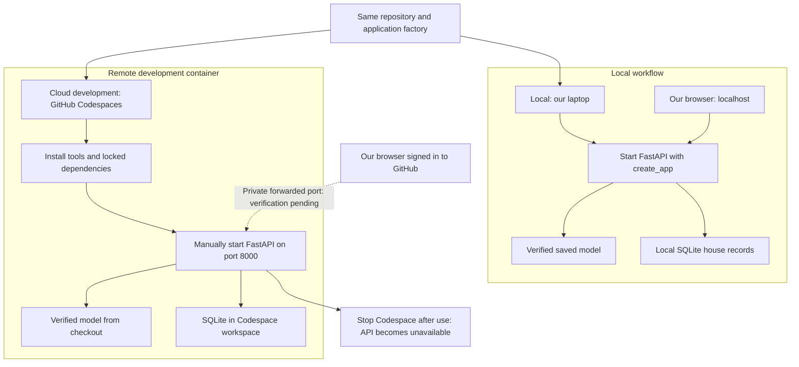

# Private development with GitHub Codespaces

## What is GitHub Codespaces?

Think of it as a development computer that GitHub runs for us in the cloud.
We open its editor in a browser or connect from VS Code. The code, Python
environment and terminal commands run on that remote computer, not our laptop.
See [GitHub's introduction](https://docs.github.com/en/codespaces/about-codespaces/what-are-codespaces).

Our `.devcontainer/` files describe the tools to install. Codespaces checks out
the repository and runs that development container. We can edit code, run tests
and start the API there, much as we would locally. We still commit and push
changes normally; saving a file in Codespaces does not update GitHub's branch.

For this project, it is a **private development and demo workspace**, not a
production deployment. The API must be started manually and is unavailable when
the Codespace stops. It does not provide an always-on service for customers.
Running time and retained storage use our Codespaces allowance.

## Where does our API run?



The two paths use the same Python application, not two implementations. Each
has its own files and SQLite database; they do not automatically sync records.
**Port forwarding** connects our browser to the remote API for testing.
The dashed connection is the intended private access path, not a completed
verification; see the live check record below.
See [GitHub's port-forwarding guide](https://docs.github.com/en/codespaces/developing-in-a-codespace/forwarding-ports-in-your-codespace).

`API_MODE=local` and `API_MODE=cloud` select authentication rules, not hosting.
Either mode can run on our laptop or in Codespaces. Cloud mode requires our
application token; the private Codespaces connection is a separate GitHub
access check. The commands and token rules are explained below.

## Our current workspace

This is a private, manually started development environment, not an always-on
production service. A two-core Europe West Codespace was created and its API
tested on 29 October 2026. Private browser forwarding still needs verification;
the Codespace has been stopped, not deleted, to conserve the included allowance.
The repository's dev container installs the locked dependencies with uv 0.13.5;
it does not start the server automatically. The existing tracked model is loaded
from the checkout and verified against the checksum and trusted types in code.
No model is baked into a public image or downloaded from an unverified source.
House CRUD records use SQLite in the Codespace checkout by default; they are
separate from predictions and persist with the Codespace until removed. Treat
them as private data, review retention, and do not commit the database. Stopping
the Codespace retains them; deleting it can permanently remove them. Back up
needed records securely before deletion.

## Before creating a Codespace

- [x] Approved on 29 October 2026: two-core machine in Europe West, private
  access for the owner, and a 30-minute idle timeout. Use included allowance
  only, with no paid usage. GitHub's account-level Codespaces budget is $0 with
  paid usage blocked, and the existing default idle timeout is 30 minutes.
  Neither billing nor timeout settings were changed. Running compute and
  stored work consume the included allowance;
  [GitHub explains usage and billing](https://docs.github.com/en/billing/concepts/product-billing/github-codespaces).
- [x] The owner confirmed permission to use the tracked model for this private
  educational Codespaces demo. This is not clearance for public model hosting
  or further dataset redistribution; the separate provenance follow-up remains.
- [x] Access is restricted to the Codespace owner. A private forwarded port is only for
  the Codespace creator, not a shared production endpoint. Do not change it to
  organization or public visibility without a separate security review.

## Start and verify

After the prerequisites are approved, create a Codespace for the reviewed branch
using this repository's dev container. Wait for `postCreateCommand` to complete.
In its terminal, run:

```bash
uv run --locked uvicorn api.main:create_app --factory --host 0.0.0.0 --port 8000
```

The dev container requests forwarding for port 8000. GitHub makes forwarded ports **private by
default**, but explicitly inspect the Ports tab and confirm visibility is Private
before accessing it. From a trusted local terminal with GitHub CLI authenticated
as the Codespace creator, the visibility can also be set and inspected with:

```bash
gh codespace ports visibility 8000:private -c CODESPACE_NAME
gh codespace ports -c CODESPACE_NAME
```

Replace `CODESPACE_NAME` with the actual name. Private forwarded ports require
GitHub authentication; see [GitHub's security documentation](https://docs.github.com/en/codespaces/reference/security-in-github-codespaces).
The server binds inside the container; do not use a public port. The default
local API has no application-level authentication and relies here on the private
Codespaces tunnel. Treat access to the Codespace itself as privileged.

In a second Codespace terminal, check the server directly without forwarding:

```bash
curl --fail http://127.0.0.1:8000/health
curl --fail http://127.0.0.1:8000/predict \
  -H 'Content-Type: application/json' --data-binary @examples/house.json
```

The first response reports ready and the loaded model version; the second has a
predicted price, currency, and model version. The model must pass startup checks;
do not bypass them. Confirm both results through the private forwarded port too,
using a GitHub-authenticated browser or a locally forwarded port. Avoid placing
credentials or sensitive input in URLs, shell history, or logs.

Stop the server with Ctrl+C and explicitly stop the Codespace when finished;
closing the browser does not stop it. Stopped Codespaces can still incur storage
charges. See [stopping a Codespace](https://docs.github.com/en/codespaces/developing-in-a-codespace/stopping-and-starting-a-codespace)
and review the configured idle timeout and storage retention.

## Optional application token

### One application factory, two configurations

`create_app(settings)` is the application factory. It builds the same routes,
prediction service and SQLite repository locally or in Codespaces. Without an
explicit settings object, it reads `ApiSettings.from_environment()`. We do not
need separate local/cloud factory classes or copies of the API.

The mode controls authentication, not the machine running the API:

- `API_MODE=local` is the default. A token is optional. Bind to `127.0.0.1`
  on your laptop; in Codespaces, use only a verified private forwarded port.
- `API_MODE=cloud` requires a valid token, even on your laptop. This lets us
  test the protected configuration before hosting it.

For example, with `API_TOKEN` already set securely in the process environment,
run the protected configuration locally:

```bash
API_MODE=cloud uv run --locked uvicorn api.main:create_app --factory --host 127.0.0.1 --port 7003
```

Unset `API_TOKEN` and use `API_MODE=local` to return to unprotected local
development. Docker Compose currently supplies the local configuration; it does
not automatically forward host `API_MODE` or `API_TOKEN` variables to the API.

For an additional API layer, set `API_MODE=cloud` and `API_TOKEN` in the server
process environment before starting it. Generate a high-entropy URL-safe token
using a secure secret manager or `secrets.token_urlsafe(32)` in a private
context, without printing or saving it to shell history. Cloud mode rejects a
missing, malformed, or shorter-than-32-character token. Length is not proof of
entropy. Never commit or place it in URLs, logs, or tickets. `/health` remains
public and reports only `{"status":"ready"}`; all other HTTP routes, including
docs and prediction, require `Authorization: Bearer <token>`. The server does
not automatically load `.env`. A shared token is not per-user authorization,
rate limiting, or a substitute for keeping the port private. Restart the server
with a new secret and update clients to rotate it.

## Completion checklist

- [x] Create the approved Codespace and verify cost controls, model startup,
  health and prediction from its terminal.
- [ ] Verify private port visibility and health/prediction through the forwarded
  browser endpoint. The Ports view continued to show no forwarded ports after
  entering 8000; do not treat terminal checks as proof of browser access.
- [x] Owner: `roy-nfisch`. Owner-only access is intended. Stop through the
  Codespaces dashboard after use; follow the backup guidance above before deletion.

### Live check record — 29 October 2026

The Codespace checked out `feature/cloud-deployment` at `3eea790`, including the
merged house-record separation. The model loaded successfully. Direct terminal
requests returned `status: ready` and an example prediction of approximately
**$323,409 USD**, with model version `king-county-20261028T153712021211Z`.
No training was run. GitHub confirmed the Codespace was stopped after testing.
Its retained workspace still consumes storage allowance.

The editor's forwarding step is unresolved. No public port was enabled, no
credentials were created, and billing settings were not changed. Resume the
existing Codespace from the owner's dashboard rather than creating another one,
start the server again, and finish the private forwarding checks above. The
development image does not include `gh`; the optional CLI commands above are
for a trusted local installation with the required Codespaces permission.

T15 remains open until those live checks pass. The existing public GHCR image
predates authentication and is not a substitute for this private environment.

## Preparation review

The implementation was independently reviewed by GPT-6.1 Sol. The review found
that cloud mode accepted a weak short token and that the application factory had
grown too long. Cloud mode now requires at least 32 token characters, and the
model lifespan was extracted from the factory. Length alone does not guarantee
entropy. The reviewer independently built the development image and verified
Python 3.13.18 and uv 0.13.5 in it, and ran the focused authentication and
dev-container checks. This does not establish a successful Codespace deployment.
