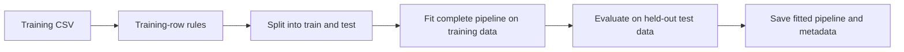
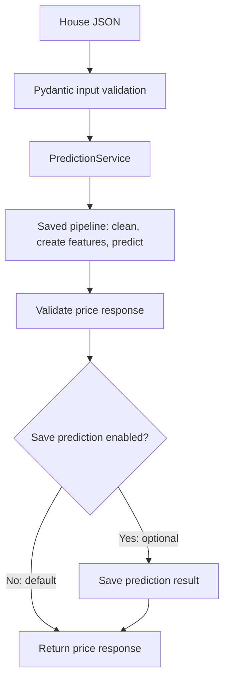

# King County: notebook to application

**Status: proposed design, awaiting review.** This document does not mean the application has been implemented.

## 1. What the notebook currently does

The notebook loads 21,597 house-sale records, cleans them, creates features, trains several regressions, evaluates them, and saves the final sklearn pipeline. Its prediction target is **total sale price in US dollars**, not the exploratory `sqft_price` ratio.

| Step | Confirmed behaviour |
|---|---|
| Clean | Remove row label 15856; rebuild basement area as living area minus above-ground area; fill missing `view` and `waterfront` with zero. |
| Construction/renovation | Use the renovation year unless it is zero or missing; otherwise use the construction year. |
| Create features | Calculate distance to a fixed reference location and to the nearest waterfront reference house. `sqft_price` is for exploration and is excluded from model inputs. |
| Split | Reserve 30% for testing using `random_state=42`. |
| Train | Compare linear and polynomial regressions, then tune a pipeline containing polynomial features, scaling, and ElasticNet with target scaling. |
| Save | Write the selected pipeline to `model/model.bin` using skops. |

The saved notebook reports adjusted R² values of **0.43**, **0.48**, and **0.75** for the earlier models, and ordinary test R² **0.844** for the final model. These are recorded outputs, not newly reproduced results. Adjusted and ordinary R² are different measures; neither means "84.4% of predictions are correct."

### What we inspected in the artifact

The local artifact exists and is 69,583 bytes. Its JSON schema was read without deserialising Python objects. It describes polynomial expansion, input scaling, and an ElasticNet regressor with target scaling. The stored sklearn version is 1.9.0.

It expects these **19 prepared features in this order**:

```text
bedrooms, bathrooms, sqft_living, sqft_lot, floors,
waterfront, view, condition, grade, sqft_above,
sqft_basement, zipcode, lat, long, sqft_living15,
sqft_lot15, last_known_change, center_distance, water_distance
```

It does not contain the earlier cleaning or waterfront reference-building steps. Loading this file alone will not turn raw house details into a prediction. Runtime loading and prediction have not yet been tested by the agent.

`model/` is ignored by Git. A fresh clone therefore cannot depend on our local file. We need documented notebook training and artifact-export steps before claiming the Docker application is reproducible.

## 2. The proposed pattern: small objects working together

Use **composition**: each class owns one job and receives the components it needs. Do not add a generic framework, a base class for every service, or a database before it is needed.

| Component | Its job | What it must not do |
|---|---|---|
| `HouseCleaner` | Apply the stated cleaning rules to a copy of the input table. Use sklearn's transformer interface. | Train a model or silently remove prediction rows. |
| `HouseFeatureEngineer` | Learn and retain waterfront reference locations in `fit`; create distances and ordered features in `transform`. | Learn new references from prediction requests or use sale price as an input. |
| `PredictionService` | Verify the pinned model checksum before loading the trusted fitted pipeline once; turn validated house details into a prediction. | Refit preprocessing, retrain, or save house records. |
| Pydantic models | Define house inputs, application settings, and prediction responses with explicit validation. | Learn data patterns or establish that a prediction is accurate. |
| FastAPI routes | Pass requests to the service and return responses/errors; optionally save a validated prediction result before returning it. | Duplicate cleaning or model logic. |

### Where these jobs come from in the notebook

Cell numbers below count **all cells, including Markdown**, starting at 1. `In[...]` identifies this saved run and can change after rerunning. Search for the shown heading or code to find the same step.

| Proposed component | Notebook heading and cells | Recognisable code / move |
|---|---|---|
| `HouseCleaner` | **Data Preparation**, code cells 31, 36, 39, 42–44 (`In[10]`, `In[13]`, `In[15]`, `In[17]`–`In[19]`). | Rebuild `sqft_basement`; fill `view` / `waterfront`; create `last_known_change`. Cell 29's fixed-row exclusion belongs to training-row rules, not request cleaning. |
| `HouseFeatureEngineer` | **Feature Engineering**, cell 61 (`In[28]`); **Distance to the waterfront**, cells 68–71 (`In[32]`–`In[35]`); **Modeling**, cells 79–81, 93, 102. | Create `center_distance` / `water_distance`, then select and order inputs. `X_train.columns` shows 20 columns; dropping `id` leaves 19. Do not include the exploratory `sqft_price`. |
| Notebook training — stays in the notebook | **Data Preparation**, cell 29; **Modeling**, cells 79–83; **Regularization and Hyperparameter Tuning**, cells 118–121; **Save the Model**, cell 132. | Import our preprocessing classes, then apply training-row rules, split, fit/tune, evaluate, and save the complete pipeline. Do not turn these steps into an application service. |
| `PredictionService` | **Regularization and Hyperparameter Tuning**, cell 124 (`In[73]`) calls `elastic.predict(X_test_poly)`. | Reuse that prediction operation with the complete saved preprocessing pipeline. Startup loading and HTTP requests are new application code, not existing notebook steps. |
| Pydantic models | No corresponding notebook implementation. **Business Understanding**, cell 5, describes dataset fields. | New validation around incoming house JSON, settings, and outgoing results. |
| FastAPI routes | No corresponding notebook implementation. | New API boundary; the separate `bonus_solution/` demonstrates CRUD, not this prediction API. |

The notebook creates waterfront references before splitting. Moving reference fitting inside the training pipeline is a deliberate change, explained in section 3; the table maps responsibilities, not an identical execution order.

This is the familiar application shape: **validated request → service → validated response**. The sklearn pipeline remains the mechanism that runs preprocessing and prediction in order; our small classes supply the project-specific behaviour.

### Training in the notebook: build and save what prediction will reuse

The working notebook imports `HouseCleaner` and `HouseFeatureEngineer`. Data splitting, model training, tuning, evaluation, prediction for error analysis, and model saving stay in the notebook. The application only loads the exported pipeline and predicts; it does not run or serve the notebook. No training service, training endpoint, or scheduled retraining is needed.



### Prediction: use the saved pipeline, without fitting again



**These are two different saves.** The notebook saves the fitted model for reuse. The optional prediction step saves a result before returning it; it does not retrain or modify the model. Keep result saving outside `PredictionService` and use a small helper first, not a database framework. This remains optional, off by default, and separate from Stage 2 house CRUD. If enabled saving fails, return a clear error rather than claiming the result was saved.

### Initial app scope

- Use FastAPI with `/predict`, `/health`, and interactive `/docs` as the first usable interface. A separate frontend is not required for this first stage.
- Accept the raw inputs described below, not `price`, `sqft_price`, an ID, or manually computed distance features. Reject missing required inputs rather than inventing values.
- Rebuild basement area and the last-known-change field using the notebook rules. Preserve the distance formulas in the first implementation.
- In the notebook, save the complete fitted pipeline, including geographic reference state, rather than only the final estimator steps. Record feature order, dependencies, data/model version, split settings, and measured metrics alongside it. The app only loads this artifact.
- Load only the project's own trusted artifact, after verifying the checksum described below. Do not accept uploaded model files or blindly trust all types reported by a loader.
- Keep our notebook and existing model unchanged as reference material. Write refactored artifacts to a separate location.

### What if we do not have all the inputs?

**We cannot use the existing model with only five fields.** A working endpoint does not remove the model's information requirements. For the first local demonstration, we can use feature-only examples from the supplied CSV. For a genuinely new house, we need the same information from a user or a verified data source.

| Source | Fields / behaviour |
|---|---|
| Required house details | `bedrooms`, `bathrooms`, `sqft_living`, `sqft_lot`, `floors`, `condition`, `grade`, `sqft_above`, `yr_built`. |
| Location | `zipcode`, `lat`, `long`. The app has no address lookup yet. |
| Dataset-specific details | `sqft_living15`, `sqft_lot15`: the supplied neighbouring-house measurements. These are not the current house's areas. Their exact aggregation is not established by the notebook, so do not invent a calculation for new houses. |
| Explicit notebook missing-value rules | Require the keys `view`, `waterfront`, and `yr_renovated`, but allow `null`. Fill null `view` / `waterfront` with 0; use `yr_built` when `yr_renovated` is null or 0. These are documented transformations, not guessed defaults for unrelated fields. |
| Computed by our pipeline | `sqft_basement = sqft_living - sqft_above`; derive `last_known_change`; calculate both distances from coordinates and stored reference locations. |

That is **17 raw input fields → 19 prepared model features**. Basement area and three derived features are calculated; the two raw year fields are replaced by one. Input validation must reject inconsistent areas, such as above-ground area exceeding total living area.

This proposed request example comes from the first CSV record, with the empty `waterfront` value represented as `null`. No sale price, ID, date, or precomputed features are sent:

```json
{
  "bedrooms": 3,
  "bathrooms": 1.0,
  "sqft_living": 1180,
  "sqft_lot": 5650,
  "floors": 1.0,
  "waterfront": null,
  "view": 0.0,
  "condition": 3,
  "grade": 7,
  "sqft_above": 1180,
  "yr_built": 1955,
  "yr_renovated": 0.0,
  "zipcode": "98178",
  "lat": 47.5112,
  "long": -122.257,
  "sqft_living15": 1340,
  "sqft_lot15": 5650
}
```

This is an input example, not evidence of performance on an unseen house. Use held-out records for evaluation. A reference house ID may select an example locally, but it is not a feature sent to the model.

If the intended interface must work with fewer details, the alternative is to **train and evaluate a separate model using only those available fields**. It will have a different input contract and may have different quality. Do not silently fill unknown neighbouring measurements with zeros or reuse the current 19-feature artifact with a shorter request. Automatic property-data lookup is outside the initial scope.

## 3. Decisions that must stay visible

**Notebook parity versus app behaviour:** first compare extracted transformations with fixed notebook examples. The original notebook builds its waterfront reference list before splitting the dataset. In the working notebook, fit the reusable pipeline on training rows only, so its reference locations can be saved and reused at inference. This is an intentional training-boundary change, not a claim of identical predictions or the same 0.844 score. Evaluate and document it separately.

**Row removal:** the notebook drops a fixed row label. That is tied to this CSV, not a general validation rule. Record the known exclusion for the training baseline, then agree on an explicit rule. Prediction requests must produce a result or a clear validation error, not silently disappear.

**Current limitations:** the source sales are from 2014–2015, so this is an educational demonstration, not a current property valuation service. The notebook uses a shuffled row split and contains repeated house IDs. We have not established performance on future sales or entirely unseen properties.

**Stale narrative:** the final notebook paragraph says roughly 83%, while this saved run reports R² 0.844. Some later outlier lookups also use fixed house IDs rather than the IDs produced by this run. Keep these as documented observations; do not silently change the notebook or turn them into portfolio claims.

## 4. Tests, logging, and failure behaviour

### Model integrity before loading

Keep an `EXPECTED_MODEL_SHA256` constant in the prediction module, reviewed in Git alongside the model version. At startup, `PredictionService` reads the model bytes, calculates their SHA-256 checksum, and compares it with that constant **before deserialising anything**. A mismatch stops startup with a clear error. Load the same verified bytes rather than reopening the path after checking it.

The current notebook artifact, `model/model.bin`, has this verified checksum:

```text
2ba5c24e79ec5563ef40420870a22ae2c8d6300a2afa097c05ea7bf3493359de
```

This value identifies our existing artifact, not the future complete pipeline. When we deliberately export a replacement from the notebook, calculate its checksum, review the model and its evaluation, and update the pinned constant in the same release. Do not automatically replace the expected checksum at startup or accept one supplied with an uploaded file.

This is an **integrity check**: it detects a changed, corrupted, or wrong artifact relative to the approved code. It is not a digital signature, a model-quality check, or permission to load an untrusted model. Anyone able to change both the artifact and the trusted code can replace both; code review and deployment access still matter. Keep skops' type checks; do not automatically trust every reported type. No model-upload endpoint is planned.

### Behaviour checks

- Unit tests cover cleaning values, missing values, distance examples, feature order, and preservation of row labels and input data.
- Integration tests cover artifact round-trip prediction and the API using a small controlled fitted model. Test startup failure for a missing/incompatible artifact and rejection of invalid requests.
- Check that the approved artifact passes checksum verification, while modified, truncated, or wrong files are rejected before the model loader is called. These checks are planned, not implemented yet.
- Compare tables with pandas testing helpers and floats with a justified tolerance. Full model quality belongs in a repeatable evaluation, not an assertion that every prediction equals its true sale price.
- Keep small deterministic checks in PR CI. Do not run expensive grid searches or depend on cloud credentials for ordinary unit tests.
- Use standard Python logging for startup, training stages, and failures. Do not log complete requests or secrets. A healthcheck passing is not evidence of prediction quality.
- Use explicit exceptions/validation errors at runtime, not Python assertions. Do not hide failures or silently clamp an implausible model output; agree on the API's failure policy and test it.

### A lightweight audit, not another platform

**Recommendation:** keep a small structured prediction log so we can answer: "Which model handled this request, did it succeed, and how long did it take?" Use standard logging with a request ID, UTC timestamp, model version, outcome, and duration. This is operational evidence, not a tamper-proof compliance audit or proof that a price is correct.

The optional **save prediction result** step in the diagram can write a JSON Lines file: one record per validated result, containing the same request ID, timestamp, model version, predicted price, and currency. Propose `SAVE_PREDICTIONS=false` as the default. Do not store raw house inputs, exact locations, personal information, or secrets by default. Minimal result records are not enough for exact input replay; if we later need that, agree on consent, access, retention, and storage first.

For the local prototype, use a configured writable file location and test the enabled, disabled, and write-failure paths. Container-local files are temporary unless persisted with a volume; do not claim otherwise. A database, audit dashboard, checksum chain, and permanent request storage are unnecessary for Stage 1. Before exposing this publicly, agree on access and retention rather than turning optional saving on automatically.

## 5. Stage 2 without premature scaffolding

House CRUD is a separate feature: API routes → a house storage component → database. It should not be added inside `PredictionService`.

When the application code exists, add a short `TODO(stage-2)` at its route-registration boundary for house CRUD and persistence. Track it in [T14](../tasks.md#stage-2--deferred). No empty repository classes or database container are needed now. This separation reduces future rework; it does not guarantee zero refactoring.

## 6. Review and delivery

Review this design before implementation. Then use small feature branches and PRs for foundations, preprocessing, notebook integration/model export, API, Docker, and documentation. Add tests with each behaviour. CI/CD starts with automated checks; automatic deployment is a later decision.

Keep [tasks.md](../tasks.md) current. The final README and walkthrough will explain how each notebook step became a class or pipeline step and how another person can run the app locally. A PDF/presentation or cloud deployment can follow once the local application works.
