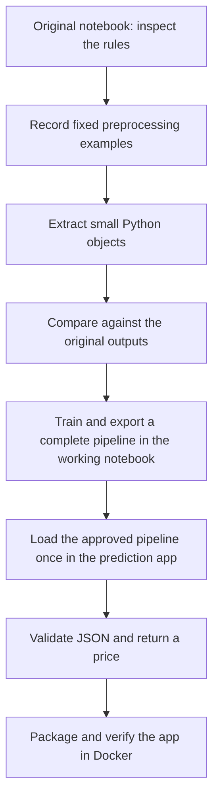

# From notebook to a working prediction app

## What we set out to do

The course's core task was to move data cleaning and feature engineering out
of a notebook and into reusable Python code. We kept EDA and training in the
notebooks. We then extended our project with a prediction API, tests, and Docker.
The API predicts total house-sale price in USD; it does not implement the
course's optional house CRUD/database application.

## The journey



| Before | What we changed | Where to look |
|---|---|---|
| Cleaning depended on notebook cell order. | `HouseCleaner` applies fixed rules to a copy; separate validators check inputs. | `src/king_county/cleaning.py`, `validation.py` |
| Geographic features were calculated inline. | `HouseFeatureEngineer` learns waterfront references in `fit()` and reuses them in `transform()`. | `src/king_county/features.py` |
| Refactoring could silently change values. | Fixed examples compare the original and working notebooks with the same CSV rows. | `tests/notebooks/`, [baseline reference](notebook-baseline.md) |
| The legacy saved model expected already-prepared features. | Export the complete cleaning/features/estimator pipeline from the working notebook. | `King-County-refactored.ipynb` |
| There was no application input contract. | Pydantic requires 17 raw fields; the pipeline creates 19 prepared features. | `src/king_county/schemas.py` |
| Predictions required notebook state. | `ModelArtifact` verifies approved bytes; `PredictionService` reuses the loaded pipeline without training. | `src/king_county/artifacts.py`, `prediction.py` |
| Running required a Python environment on the host. | Docker packages the runtime; the approved model is mounted read-only, not baked into the image. | `Dockerfile`, `compose.yaml` |

We used composition: objects have separate jobs and work together. A training
service, database, and generic framework would add complexity without helping
the current prediction use case.

## Follow one request

Use [the runnable README commands](../README.md#run-the-prediction-api) and
[`examples/house.json`](../examples/house.json); there is no need to type 17 fields.

```text
House JSON → Pydantic → PredictionService
  → saved cleaning/features/model pipeline → validated USD price response
```

The response has `predicted_price`, `currency`, and `model_version`. The exact
price comes from the model; it is not a hand-written expected business value.
Invalid inputs return 422. A missing or unapproved artifact blocks startup.
Readiness means the model loaded, not that its predictions are accurate.

## How we checked the result

- **Unit tests:** individual transformations, validation rules, and boundaries.
- **Integration tests:** notebook export → verified loader → API, plus the
  real Docker runtime. Small temporary models keep most checks quick.
- **Contract tests:** independent expectations for request/response fields
  and safe validation errors, so clients do not silently break.
- **Model evaluation:** a separate held-out evaluation, not a unit-test result.

The recorded refactored run achieved **R² 0.8447**, **MAE $94,808**, and
**RMSE $143,443** on 6,479 test rows. R² is not percentage accuracy. These results
come from one shuffled split of 2014–2015 sales; repeated house IDs can cross
that split. See [the evaluation evidence](notebook-baseline.md#model-training-and-export).

## Challenges and decisions

1. **Keep behaviour while changing structure.** We recorded notebook outputs
   before extracting code and kept the original notebook unchanged.
2. **Avoid learning from test inputs.** Baseline comparison intentionally uses
   all retained rows, but actual training fits a fresh pipeline inside each
   training fold. Prediction never adds new waterfront reference houses.
3. **Keep test feedback fast.** We separated unit, integration, contract, and
   Docker checks into CI jobs that run in parallel after lint/build. Each test
   runs in only one job. Within the non-Docker integration job, two pytest
   workers share the work by file. We kept other jobs serial internally because
   more workers did not always make them faster.
4. **Plan tasks before writing code.** We used `tasks.md` to agree on scope and
   completion checks before implementation. Small tasks and focused PRs helped
   us review one change at a time and leave optional features for later.
5. **Keep object-oriented design simple.** We gave each object one clear job
   and used composition to connect them. Validation, cleaning, feature creation,
   model loading, and prediction stay separate. We avoided extra layers or
   classes that did not make the code easier to understand or test.
6. **Load only the approved artifact.** A code-pinned checksum and explicit
   custom-type allowlist protect loading. They do not prove model quality or
   grant permission to redistribute training-derived information.
7. **Separate publishing from deployment.** A private GHCR image is a packaged
   runtime, not a public service. It still needs the approved model and should
   bind only to localhost for this unauthenticated demonstration.
8. **Audit each task with a different model.** Our review rule going forward is
   to use a model different from the one that implemented the task. Check scope,
   correctness, security, missing tests, and unnecessary complexity before
   marking it complete. Record findings and rerun checks after fixes. A second
   model can still be wrong; its review does not replace tests or our judgment.
9. **Challenge and steer the work as it develops.** Do not accept generated
   output just because it looks convincing. Ask why a design is needed, compare
   it with the course task, and request evidence. Review the plan and small
   changes while work is in progress, so feedback corrects the direction before
   a large implementation is finished.

## With more time

Evaluate grouped or time-based splits and performance across price/location
groups before considering real-world use. Confirm dataset/model redistribution
permission. Add authentication and operational limits before public hosting.
CRUD, a Streamlit interface, and cloud deployment remain separate optional work,
not requirements to finish the refactoring core.
